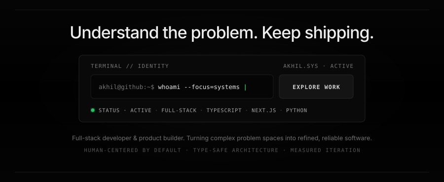
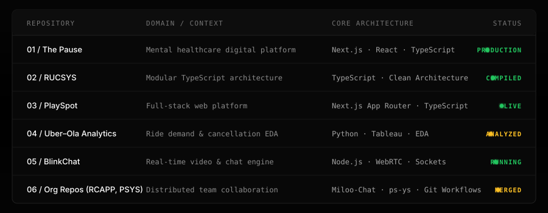
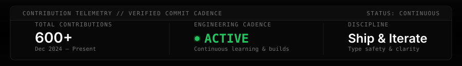

<!-- HERO: Blitsum Console & Statement -->

 
 

<!-- IDENTITY CONSOLE -->

 

### `~/projects` — Work &amp; Deployment Queue

 

<b>📂 Expand Project Index &amp; Repository Direct Links</b>

 

| Index | Repository | Domain / Scope | Core Architecture | Status | Link |
| :---: | :--- | :--- | :--- | :---: | :---: |
| **01** | **The Pause** | Mental healthcare digital platform | `Next.js` `React` `TypeScript` `Tailwind` | `● PRODUCTION` | [Inspect Code →](https://github.com/AkhilSharma11681/the-pause) |
| **02** | **RUCSYS** | Modular TypeScript application system | `TypeScript` `Architecture` `Node.js` | `● COMPILED` | [Inspect Code →](https://github.com/AkhilSharma11681/RUCSYS) |
| **03** | **PlaySpot** | Full-stack web application platform | `Next.js App Router` `TypeScript` `React` | `● LIVE` | [Inspect Code →](https://github.com/AkhilSharma11681/PlaySpot) |
| **04** | **Uber–Ola Analytics** | Booking demand & cancellation EDA | `Python` `Tableau` `Pandas` `EDA` | `● ANALYZED` | [Inspect Code →](https://github.com/AkhilSharma11681/SectionC_Group04_Uber-Ola-Ride-Analytics) |
| **05** | **BlinkChat** | Real-time video & communication app | `Node.js` `Express` `WebRTC` `Sockets` | `● RUNNING` | [Inspect Code →](https://github.com/AkhilSharma11681/BlinkChat) |
| **06** | **Collaborative Repos** | Distributed team collaboration | `Miloo-Chat` `ps-ys` `Distributed Git` | `● MERGED` | [Miloo-Chat →](https://github.com/Miloo-Chat/RCAPP) · [ps-ys →](https://github.com/ps-ys/PSYS) |

*Note on team work: RCAPP and PSYS are collaborative organization codebases; Uber–Ola Ride Analytics is an academic group research project. Commit histories document verified contributions.*

---

### `~/stack` — Runtime Technologies &amp; Architecture

 

---

### `~/telemetry` — Verified Activity &amp; Composition

<!-- System Telemetry Overview -->

 
 

<!-- Codebase Composition -->

 
 

<!-- Verified Contribution & Cadence Monitor -->

 

---

### `~/principles` — Engineering Doctrine

 

---

### `connection.established` — Contact &amp; Dialogue

 
 

  <code><a href="https://github.com/AkhilSharma11681">GITHUB</a></code>
  &nbsp;&nbsp;·&nbsp;&nbsp;
  <code><a href="https://github.com/AkhilSharma11681?tab=repositories">REPOSITORIES</a></code>
  &nbsp;&nbsp;·&nbsp;&nbsp;
  <code><a href="mailto:akhil.sharma.techie@gmail.com">EMAIL</a></code>

 

<!-- Minimalist Stealth Footer -->

